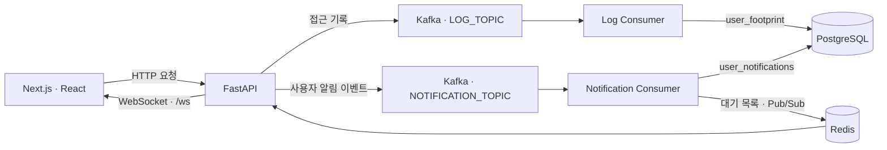

# 타르코프 도서관 · Kafka Consumers

**갱신일: 2026.10.20**

[타르코프 도서관](https://eftlibrary.com)의 **접근 기록과 사용자 알림 이벤트를 처리하는 Python consumer 프로젝트**입니다. FastAPI가 Kafka에 보낸 메시지를 받아 PostgreSQL에 저장하고, 사용자 알림은 Redis를 통해 백엔드의 WebSocket으로 전달합니다.

접근 기록과 알림은 각각 별도 프로세스로 실행합니다. Kafka broker 자체의 구현이나 게임 데이터 수집 코드는 이 저장소에 포함되어 있지 않습니다.

## 전체 서비스에서 맡은 역할


Airflow는 게임 데이터 수집·정기 갱신과 화면용 JSON 생성을, FastAPI는 API와 실시간 연결을, Next.js·React는 웹 화면을 담당합니다. 이 저장소는 백엔드에서 발생한 접근 기록과 커뮤니티 알림을 비동기로 처리합니다.



지도 위치·레이드 상태, 파티·채팅의 실시간 전달은 백엔드가 Redis와 직접 연동합니다. 이 저장소의 consumer가 해당 이벤트를 처리하는 구조는 아닙니다.

관련 저장소: [Frontend](https://github.com/eft-library/eft-library-front), [Airflow](https://github.com/eft-library/eft-library-airflow), [Backend](https://github.com/eft-library/eft-library-back).

## 접근 기록 처리

백엔드 미들웨어가 요청 처리 후 HTTP 방식, 요청 경로, 기록 시각을 `LOG_TOPIC`으로 전송합니다. 차단된 요청이나 백엔드에서 제외한 경로는 기록되지 않으므로 전체 요청을 빠짐없이 보관하는 감사 로그는 아닙니다.

```json
{
  "method": "GET",
  "link": "/api/item/v3",
  "footprint_time": "2026-10-20T10:00:00+09:00"
}
```

[로그 consumer](main_log_consumer.py)는 메시지를 다음과 같이 매핑하여 한 건씩 INSERT하고 커밋합니다.

| 메시지 필드      | `user_footprint` 컬럼 | 내용                                 |
| ---------------- | --------------------- | ------------------------------------ |
| `method`         | `request_type`        | HTTP 요청 방식                       |
| `link`           | `url`                 | 쿼리 문자열을 제외한 요청 경로       |
| `footprint_time` | `request_time`        | 백엔드가 생성한 Asia/Seoul 기준 시각 |

저장 쿼리는 [pg_client.py](consumer/pg_client.py)에 있습니다.

## 사용자 알림 처리

[알림 consumer](main_notification_consumer.py)는 `NOTIFICATION_TOPIC`에서 받은 JSON의 `noti_type`으로 처리 함수를 선택합니다. 메시지 전체를 `user_notifications.payload`에 저장하며, 수신자는 DB 조회로 결정합니다.

| `noti_type`             | 알림 대상                | 대상 조회에 필요한 메시지 필드 |
| ----------------------- | ------------------------ | ------------------------------ |
| `create_post`           | 작성자를 팔로우한 사용자 | `author_email`                 |
| `create_parent_comment` | 게시글 작성자            | `post_id`                      |
| `create_child_comment`  | 부모 댓글 작성자         | `parent_comment_id`            |
| `follow_user`           | 팔로우 알림 대상 사용자  | `follower_email`               |
| `penalty_user`          | 제재 대상 사용자         | `user_email`                   |

위 필드와 함께 `noti_type`이 필요합니다. 화면 표시용 제목·닉네임 등 추가 payload는 백엔드의 이벤트 생성 코드와 맞춰야 합니다. 지원하지 않는 타입은 경고 로그를 남기고 건너뜁니다.

처리 순서는 다음과 같습니다.

1. 수신자별 알림을 PostgreSQL의 `user_notifications`에 INSERT하고 커밋합니다.
2. 수신자의 `notifications:{email}` Redis 목록에 메시지를 `LPUSH`합니다.
3. 목록 키에 7일 TTL을 설정합니다. 새 알림이 들어올 때마다 키 전체의 TTL이 갱신됩니다.
4. `notifications_channel:{email}` 채널로 같은 메시지를 발행합니다.
5. 백엔드가 대기 목록이나 구독 이벤트를 읽어 인증된 사용자의 `/ws` 연결로 전달합니다.

consumer는 WebSocket 연결을 직접 관리하지 않습니다. DB 저장과 Redis 발행 구현은 [notification_handler.py](consumer/handlers/notification_handler.py)에 있습니다.

## 디렉토리 구조

```text
.
├── consumer/
│   ├── config.py                     # 환경 변수와 Kafka·PostgreSQL 설정
│   ├── consumer_base.py              # Kafka 구독, poll, JSON 해석과 오류 기록
│   ├── pg_client.py                  # PostgreSQL 연결과 접근 기록 저장
│   ├── logger.py                     # 콘솔·파일 로그
│   └── handlers/
│       ├── log_handler.py            # 접근 기록 처리
│       └── notification_handler.py   # 알림 수신자 조회, DB 저장과 Redis 발행
├── main_log_consumer.py              # 접근 기록 consumer 진입점
├── main_notification_consumer.py     # 사용자 알림 consumer 진입점
├── consumer.sh                       # 운영 consumer 시작·중지·재시작
└── kafka.sh                          # 운영 Kafka broker 제어
```

## 실행 환경과 설정

Python과 `confluent-kafka`, `psycopg2-binary`, `redis`, `python-dotenv`를 사용합니다. 현재 저장소에는 Python 버전이나 의존성을 고정한 requirements·lock 파일이 없습니다.

기존 운영 기록은 단일 서버의 standalone 구성으로 Kafka `kafka_2.13-4.1.1`, PostgreSQL `17.7`, Redis `remi-8.4`를 기재하고 있습니다. 이 중 Kafka 경로는 현재 `kafka.sh`에도 지정되어 있으며, 실제 설치 버전은 운영 서버에서 확인해야 합니다.

```bash
python3 -m venv .venv
source .venv/bin/activate
python -m pip install confluent-kafka psycopg2-binary redis python-dotenv
```

프로젝트 루트의 `.env`에 다음 설정을 준비합니다. 아래 값은 로컬 개발 예시입니다.

```dotenv
DB_HOST=localhost
DB_PORT=5432
DB_NAME=platform_db
DB_USER=your-db-user
DB_PASSWORD=your-db-password

BOOTSTRAP_SERVER=localhost:9092
GROUP_ID=eft-library-consumers
OFFSET_RESET_CONFIG=earliest
LOG_TOPIC=access-log
NOTIFICATION_TOPIC=user-notification

REDIS_HOST=localhost
REDIS_PORT=6379
REDIS_DB=0
LOG_DIR=./logs
```

| 설정                                                      | 용도                                                               |
| --------------------------------------------------------- | ------------------------------------------------------------------ |
| `DB_HOST`, `DB_PORT`, `DB_NAME`, `DB_USER`, `DB_PASSWORD` | PostgreSQL 접속 정보. 두 consumer가 같은 설정 사용                 |
| `BOOTSTRAP_SERVER`                                        | Kafka broker 주소                                                  |
| `GROUP_ID`                                                | 두 consumer에서 사용하는 consumer group ID                         |
| `OFFSET_RESET_CONFIG`                                     | 유효한 커밋 오프셋이 없을 때의 시작 위치. 예: `earliest`, `latest` |
| `LOG_TOPIC`, `NOTIFICATION_TOPIC`                         | 접근 기록·알림 topic 이름. 백엔드 producer와 일치해야 함           |
| `REDIS_HOST`, `REDIS_PORT`, `REDIS_DB`                    | 알림을 전달할 Redis 접속 정보                                      |
| `LOG_DIR`                                                 | 공통 로그 디렉토리. 기본값 `./logs`                                |

이 프로젝트는 백엔드의 `V3_DB_NAME` 대신 **`DB_NAME`**을 읽습니다. 백엔드의 현재 플랫폼 DB를 가리키도록 설정하고, Redis도 백엔드의 개인 알림 연결과 같은 서버·DB를 사용해야 합니다. 여기서 `REDIS_HOST`는 호스트만 지정하고 포트는 `REDIS_PORT`로 분리합니다. `.env`의 실제 접속 정보는 커밋하지 않습니다.

DB 구조는 [백엔드의 platform_db.sql](https://github.com/eft-library/eft-library-back/blob/main/platform_db.sql)을 기준으로 준비합니다. 접근 기록에는 `user_footprint`, 알림에는 `user_notifications`와 수신자 조회용 `user_follows`, `community_posts`, `community_comments`, `user_info`가 필요합니다. 이 저장소는 테이블을 자동 생성하지 않습니다.

Kafka broker와 두 topic, PostgreSQL, 알림용 Redis를 준비한 뒤 프로젝트 루트에서 각각 별도 터미널로 실행합니다.

```bash
python main_log_consumer.py
```

```bash
python main_notification_consumer.py
```

두 프로세스는 시작 시 PostgreSQL 연결을 생성합니다. 시작에 실패하면 DB 접속 설정과 스키마부터 확인합니다. `earliest` 설정도 이미 커밋된 오프셋을 처음으로 되돌리지는 않습니다.

## 운영 실행과 확인

[consumer.sh](consumer.sh)는 `/home/kafka/eft-library-kafka`와 그 아래 `venv`를 사용하는 기존 운영 스크립트입니다. 위 개발 예시의 `.venv`와 경로가 다르므로 실제 배치 경로와 가상환경을 맞춰야 합니다. 작업 디렉토리를 바꾸지 않으므로 프로젝트 루트에서 실행합니다.

```bash
cd /home/kafka/eft-library-kafka
bash consumer.sh start
bash consumer.sh stop
bash consumer.sh restart
```

`start`는 두 consumer를 백그라운드로 실행하고 `log.pid`, `notification.pid`를 생성합니다. 표준 출력·오류는 각각 `logs/log.log`, `logs/notification.log`에 기록합니다. 공통 로거는 `LOG_DIR/consumer.log`에 기록하며 자정마다 회전하고 백업 파일 30개를 유지합니다. 두 프로세스가 공통 파일을 사용하므로 운영 시 로그 회전과 파일 상태도 확인합니다.

[kafka.sh](kafka.sh)는 `/home/kafka/kafka_2.13-4.1.1/config/server.properties`로 broker를 KRaft 모드에서 실행합니다.

```bash
bash kafka.sh start
bash kafka.sh status
bash kafka.sh stop
bash kafka.sh restart
```

이 스크립트는 Kafka 설치, KRaft 저장소 초기화, topic 생성까지 수행하지 않습니다. `status`도 PID의 프로세스 존재 여부만 확인합니다. consumer 시작 메시지만으로 정상 처리를 판단하지 말고 구독 로그, 실제 DB 적재와 Redis·WebSocket 전달 결과를 함께 확인합니다.

## 메시지 처리 시 알아둘 점

현재 [공통 consumer](consumer/consumer_base.py)는 Kafka의 기본 자동 오프셋 커밋을 사용하며, DB 저장 완료와 오프셋 커밋을 묶지 않습니다. 실패한 메시지의 명시적 재시도·별도 실패 topic·중복 방지 처리는 구현되어 있지 않습니다. 처리 실패가 기록되더라도 다음 메시지로 진행할 수 있으며, 재처리 시 DB 중복 저장도 가능합니다.

알림은 DB 커밋 후 Redis에 발행합니다. Redis 처리 중 실패하면 DB 알림만 남거나 일부 수신자에게만 전달될 수 있고, 이후 `rollback`으로 이미 커밋한 알림을 취소할 수는 없습니다. 접근 기록 DB 오류에는 별도 rollback이 없어 후속 쿼리가 실패할 수 있으며, 두 consumer 모두 DB 연결 자동 재생성은 구현되어 있지 않습니다.

로그에는 수신 메시지 전체와 알림 수신자 정보가 포함될 수 있습니다. 운영 로그를 공유할 때는 이메일 등 사용자 정보를 확인합니다.

## 개발 기록

구현 과정은 [접근 기록·Kafka 개발 기록](https://github.com/eft-library/eft-library-history/blob/main/kafka/user_footprint.md)에 정리하고 있습니다.

카프카는 좀 빈약해서 ;;;

다른 내용도 많으니 많이 놀러와주세용 !
